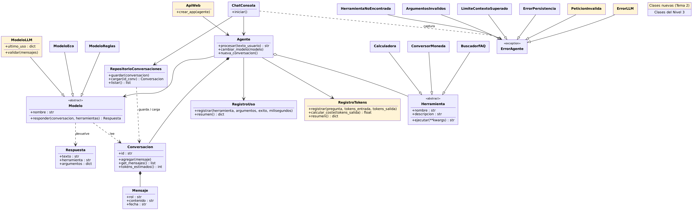
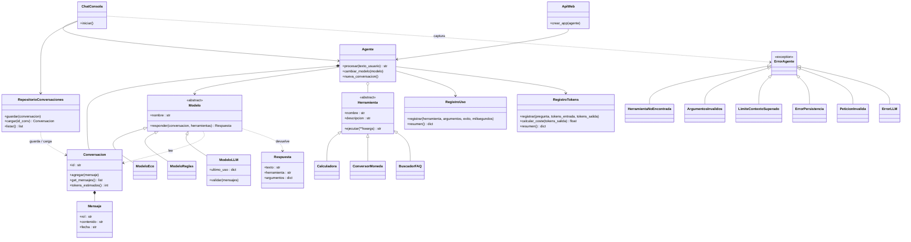

# NEXO · asistente de TechNova (Nivel 3: agente pro)

Agente de IA en Python con arquitectura por capas. Tiene tres modelos: `ModeloEco`, `ModeloReglas` (sin IA, con reglas) y `ModeloLLM`, que habla con un LLM real. Se puede usar desde la consola o desde una página web.

## Ejecución

```bash
python3 -m venv .venv && source .venv/bin/activate   # en Windows: .venv\Scripts\activate
pip install -r requirements.txt   # pytest, httpx, fastapi, uvicorn, python-dotenv
cp .env.example .env              # y rellena tus datos (ver "Configuración del LLM")
python main.py                    # chat por consola
python web.py                     # API web en http://127.0.0.1:8000 (para el frontend)
python comparar_modelos.py        # compara ModeloReglas y ModeloLLM con 10 preguntas
pytest                            # pruebas (106; no necesitan LLM ni internet)
```

`main.py`, `web.py` y `comparar_modelos.py` se ejecutan desde la raíz del proyecto. Sin LLM, el chat y la API funcionan igual con `ModeloReglas`.

## Estructura

| Capa | Archivos |
|---|---|
| Presentación | `presentacion/chat_consola.py`, `presentacion/api_web.py` |
| Servicios | `servicios/agente.py` |
| Dominio | `dominio/excepciones.py`, `mensaje.py`, `herramientas.py`, `modelos.py`, `modelo_llm.py` |
| Persistencia | `persistencia/repositorio_conversaciones.py`, `registro_uso.py`, `registro_tokens.py` |
| Conexión | `main.py` (consola) y `web.py` (API web): los únicos sitios donde se unen las piezas |
| Script | `comparar_modelos.py` (compara dos modelos con 10 preguntas) |

No hay `print()` ni `input()` en `dominio/` ni `servicios/` (lo verifica una prueba).

## Comandos del chat

| Comando | Acción |
|---|---|
| texto normal | Se envía a NEXO |
| `/herramientas` | Lista las herramientas |
| `/modelo eco` · `/modelo reglas` · `/modelo llm` | Cambia de modelo en caliente |
| `/historial` | Mensajes, roles y tokens estimados |
| `/guardar` | Guarda la conversación actual e informa de su id |
| `/cargar <id>` | Restaura una conversación completa en el agente |
| `/lista` | Conversaciones guardadas |
| `/nueva` | Nueva conversación (con id nuevo; las guardadas no se tocan) |
| `/stats` | Resumen del registro de uso |
| `/salir` | Termina |

Los errores (`ErrorAgente` y derivadas, o cualquier fallo inesperado) se muestran como mensaje y el chat sigue abierto.

## Persistencia JSON

`RepositorioConversaciones(carpeta="datos/conversaciones")` guarda cada conversación en `<id>.json`
(`to_dict()`, UTF-8, escritura atómica) y la reconstruye con `Conversacion.from_dict()` / `Mensaje.from_dict()`,
conservando id, fechas, roles, contenidos y orden. Los ids solo admiten `A-Z a-z 0-9 _ -`, así que no se puede
salir de la carpeta (`../x`). Id inexistente, JSON corrupto o contenido inválido lanzan `ErrorPersistencia`
(subclase de `ErrorAgente`).

## Registro CSV

`RegistroUso("datos/uso.csv")` añade una fila por ejecución de herramienta, éxito o fallo:
`fecha,herramienta,argumentos,exito,milisegundos` (cabecera una sola vez, duración medida con `perf_counter`).
`resumen()` devuelve `{"total", "usos", "fallos"}` (a cero si no hay registros). El agente funciona igual con `registro_uso=None`.

## Ampliación (Tema 2): LLM real, frontend web y comparación

### Configuración del LLM
`ModeloLLM` habla con cualquier API compatible con OpenAI. Yo lo probé con **Ollama** (gratis, en mi ordenador) y el modelo `llama3.2`:

1. Instala Ollama (ollama.com) y descarga el modelo: `ollama pull llama3.2`.
2. Copia `.env.example` como `.env` y rellénalo. **`.env` está en `.gitignore`: nunca se sube.**

```
LLM_API_KEY=ollama
LLM_MODEL=llama3.2
LLM_BASE_URL=http://localhost:11434/v1
NEXO_MODELO=reglas        # modelo que usa web.py: reglas, eco o llm
```

Con otro proveedor (por ejemplo OpenAI) solo cambian estas tres variables. `main.py` y `web.py` leen el `.env` con `python-dotenv`; el dominio no lee archivos.

### ModeloLLM (`dominio/modelo_llm.py`)
Hereda de `Modelo`, así que **el `Agente` no cambió**.
- **Validación** antes de enviar: lista de mensajes no vacía, el último es del usuario, `max_tokens > 0` y `0 ≤ temperature ≤ 2`. Si falla, lanza `PeticionInvalida`.
- **Reintentos** con espera creciente (1, 2, 4... hasta 10 s) solo con errores 429 y 5xx, y hasta 5 intentos. Los errores 400, 401 y 404 no se reintentan. Si todo falla, `ErrorLLM`.
- Traduce los roles de NEXO (`usuario`/`asistente`) a los de la API (`user`/`assistant`).
- Guarda los tokens de la última respuesta en `ultimo_uso`.
- Las dos excepciones nuevas heredan de `ErrorAgente`, así que el chat las muestra y sigue abierto.
- **Limitaciones:** no usa streaming real (espera la respuesta entera) y todavía no le pide herramientas al LLM: solo responde con texto.

### Registro de tokens y coste (`persistencia/registro_tokens.py`)
`RegistroTokens("datos/uso_llm.csv")` añade una fila por cada respuesta del LLM: `fecha,pregunta,tokens_entrada,tokens_salida,coste`.
El coste es `tokens_salida × precio / 1000`, con un precio de ejemplo de **0,008 € por cada 1000 tokens de salida** (cambiable con `precio_por_1000`). Con Ollama el coste real es cero; es solo un ejercicio.
El `Agente` lo anota solo si el modelo informa de sus tokens (`ModeloLLM` sí, los otros no). Ejemplo real:

```
fecha,pregunta,tokens_entrada,tokens_salida,coste
2026-11-19T22:47:36,explícame qué es una lista en Python en dos frases,38,78,0.000624
```
(78 × 0,008 / 1000 = 0,000624 €.)

### Frontend web
`web.py` arranca una API (`presentacion/api_web.py`, FastAPI) que habla el formato de OpenAI: `POST /v1/chat/completions` y `GET /v1/models`. Por eso sirve casi cualquier frontend de chat.

- Frontend usado: **[AI-QL/chat-ui](https://github.com/AI-QL/chat-ui)**, un único `index.html` que no he modificado. Consulta su repositorio para ver su licencia.
- Para usarlo: `python web.py`, abre `index.html` en el navegador, pulsa la rueda de ajustes y pon:
  - **API Key:** cualquier texto (la API no la comprueba).
  - **URL:** `http://127.0.0.1:8000/v1` · **Path:** `/chat/completions` · **Model:** `nexo`.
- El frontend manda todo el historial en cada mensaje, pero el `Agente` ya guarda el suyo, así que la API usa solo el último mensaje del usuario. Si llega un solo mensaje, entiende que es un chat nuevo.
- CORS está activado para que el navegador deje llamar a la API desde un `index.html` local.
- **Limitación:** el streaming es simulado. El agente calcula la respuesta entera y la API la envía palabra a palabra.

Ejemplo sin frontend:
```bash
curl -X POST localhost:8000/v1/chat/completions -H "Content-Type: application/json" \
     -d '{"messages":[{"role":"user","content":"cuánto son 250 USD en euros"}]}'
# → {"object":"chat.completion", ..., "choices":[{"message":{"role":"assistant","content":"250 USD = 230.00 EUR."}, ...}]}
```

### Comparación de modelos (`comparar_modelos.py`)
Hace las mismas 10 preguntas a `ModeloReglas` y a `ModeloLLM` (cada una en una conversación nueva), guarda respuestas, tiempos y tokens **en listas**, cuenta los errores y escribe `datos/comparacion.csv` (se abre con doble clic en Excel). Resultado de mi ejecución (llama3.2 en mi ordenador):

| | ModeloReglas | ModeloLLM |
|---|---|---|
| Tiempo medio por pregunta | 0,00 s | 8,96 s |
| Tokens de salida (10 preguntas) | 0 | 730 |
| Coste (precio de ejemplo) | 0 € | 0,00584 € |
| Errores | 0 | 0 |

Extracto de las respuestas:

| Pregunta | ModeloReglas | ModeloLLM |
|---|---|---|
| `12 * 7` | El resultado es 12 * 7 = 84. | 12 * 7 = 84 |
| ¿puedo pagar con Bizum? | Aceptamos tarjeta, Bizum y PayPal. | No tengo información sobre el pago a través de Bizum. |
| ¿cuál es la capital de Francia? | No estoy seguro, ¿puedes reformularlo? | La capital de Francia es la ciudad de París. |
| multiplica 15 por 4 y luego réstale 10 | No estoy seguro, ¿puedes reformularlo? | (explica los pasos) La respuesta final es 50. |

**Conclusiones**
1. **Precisión.** Las reglas acertaron las 6 preguntas que tenían programadas (cálculos, conversión, FAQ y saludo) y no entendieron las otras 4. El LLM contestó las 10 y acertó el cálculo (50), pero no conoce los datos de la tienda, así que no dio los plazos ni el horario reales de la FAQ.
2. **Velocidad.** Las reglas responden al instante y el LLM tardó unos 9 segundos por pregunta. Ese tiempo depende de mi ordenador y del modelo; con otro equipo saldría distinto.
3. **Consumo de tokens.** Las reglas no gastan tokens; el LLM gastó 730 en 10 preguntas. Con Ollama no se paga nada, pero con un proveedor de pago sería dinero.
4. **Facilidad de uso.** Las reglas no necesitan instalar nada, pero cada pregunta nueva exige programar una regla. El LLM contesta casi cualquier cosa sin programar, pero necesita Ollama, un modelo de unos 2 GB, un `.env` y un ordenador que lo aguante.
5. **Robustez.** Las reglas siempre dan la misma respuesta y no fallan, pero dicen "No estoy seguro" cuando algo se sale de lo previsto. El LLM tiene más puntos que pueden fallar (Ollama apagado, tiempos de espera, respuestas inventadas).

## Retos del Nivel 3

### Reto 4: varias herramientas en una pregunta
«convierte 100 USD a euros y multiplícalo por 3» → `conversor_moneda` → `calculadora` → respuesta:
`Primero, 100 USD = 92.00 EUR; después, 92 * 3 = 276.`

**El agente no se ha modificado.** Su bucle ya permite hasta 3 vueltas. Es `ModeloReglas` quien, al ver el
primer resultado, detecta una segunda operación en la pregunta («multiplícalo por», «divídelo entre»,
«súmale», «réstale») y pide otra herramienta con el número del resultado anterior. Si el primer paso falla,
no encadena.

### Reto 5: tests con `pytest`
La carpeta `tests/` replica la estructura del proyecto:

```
tests/
├── dominio/        test_excepciones · test_mensaje · test_herramientas · test_modelos · test_modelo_llm
├── servicios/      test_agente · test_agente_tokens
├── persistencia/   test_repositorio_conversaciones · test_registro_uso · test_registro_tokens
├── presentacion/   test_chat_consola · test_api_web
├── test_main.py          ← main.py (ciclo real guardar → cerrar → reabrir → cargar)
├── test_comparar_modelos.py  ← el script de comparación, con un LLM falso
├── test_arquitectura.py  ← reglas globales: sin print/input en dominio/servicios, sin isinstance en el agente
└── ayudantes.py          ← crear_agente(), ejecutar_chat()
```

El dominio se puede probar sin entrada ni salida porque no tiene `input()` ni `print()`. El chat se prueba
inyectando `entrada`/`salida` en `ChatConsola`. `ModeloLLM` se prueba con una API falsa (`httpx.MockTransport`), así que los tests no necesitan Ollama ni internet.

### Reto 6: resumen automático
Cuando `Conversacion.agregar()` detecta que se superaría el **80 %** del límite de tokens, sustituye los
mensajes antiguos por un único mensaje-resumen (`[Resumen de N mensajes anteriores] Temas: …`) y conserva
intactos los más recientes (hasta 4, o menos si hace falta para bajar del 80 %).
- El resumen recoge las preguntas del usuario y arrastra los temas de resúmenes anteriores, sin anidarlos.
- Ocupa como máximo el 25 % del límite: los temas más antiguos se van descartando.
- Si ni resumiendo cabe el mensaje (por ejemplo, uno enorme), se lanza `LimiteContextoSuperado` y la
  conversación no cambia.
- El chat avisa con `🗜 He resumido los mensajes antiguos…`.
- Se puede desactivar con `Conversacion(resumen_automatico=False)`.

## Diagrama de clases

Solo aparecen los métodos públicos principales. Los detalles están en el código de cada clase. **La imagen es la del Nivel 3 (sin la ampliación); el código Mermaid de abajo sí incluye `ModeloLLM`, `ApiWeb`, `RegistroTokens` y las dos excepciones nuevas.**



<details>
<summary>Código Mermaid (GitHub lo dibuja; también se puede pegar en mermaid.live)</summary>



</details>

**Cómo leerlo:**
- **Herencia** (`<|--`): los 3 tipos de herramienta, los 3 modelos y las 6 excepciones heredan de su clase base. El agente usa herramientas y modelos a través de la base, sin saber cuál es cuál (polimorfismo).
- **Composición** (`*--`): el `Agente` crea **su** `Conversacion`, y la `Conversacion` está formada por `Mensaje`s.
- **Agregación** (`o--`): el `Agente` usa herramientas que se crean **fuera**, en `main.py`.
- **Asociación** (`-->`): una clase guarda una referencia a otra.
- **Dependencia** (`..>`): una clase devuelve, guarda o captura algo de otra.
- Las capas solo dependen hacia abajo: Presentación → Servicios → Dominio, y Persistencia → Dominio. `main.py` las conecta todas.

## Nivel alcanzado y uso de la IA

- Nivel alcanzado: 3, con los retos 4 (varias herramientas), 5 (pytest) y 6 (resumen automático).
- Uso de la IA (asistente: Claude Code):
  - El código del proyecto se generó con la IA a partir del enunciado.
  - El diagrama de clases: la IA hizo una primera versión detallada y después, a petición nuestra, una versión simplificada.
  - Los comentarios de una línea encima de cada función los añadió la IA.
  - Las preguntas de reflexión: respondí con mis ideas y la IA me dio pistas.
  - La ampliación del Tema 2 (`ModeloLLM`, la API web, el registro de tokens y el script de comparación) la hizo la IA (Claude, en el chat) a partir de la guía del profesor. Yo instalé Ollama, configuré el `.env` y el frontend, ejecuté las pruebas y la comparación, y comprobé los resultados (por ejemplo, los 78 tokens de salida y el coste en el CSV).
  - Lo usé también para entender conceptos (`@property`, dónde se crea el `Agente`, para qué sirve `ModeloEco`).

## Preguntas de reflexión de Zadkiel De Jesus

**1. En el Tema 2 conectaréis un LLM real. ¿Qué clase o clases tendréis que crear y cuáles tendréis que modificar? ¿Por qué?**

*Respuesta:* Habría que crear una clase nueva, por ejemplo `ModeloLLM`, que herede de `Modelo` e implemente `responder()`: ahí se hace la llamada a la API y lo que contesta se convierte en una `Respuesta` (un texto final o una herramienta con sus argumentos). Solo cambiaría `main.py`, para arrancar con `ModeloLLM`, y el diccionario `MODELOS` de `chat_consola.py` si quiero elegirlo con `/modelo`. El `Agente` no se toca, porque solo conoce la clase base `Modelo` y llama a `responder()` sin saber qué modelo es. Eso es polimorfismo: ya pasa con `ModeloEco` y `ModeloReglas`.

**2. ¿Por qué `get_mensajes()` devuelve una copia de la lista y no la lista original? ¿Qué podría pasar si no?**

*Respuesta:* Porque si devolviera la lista original, cualquiera podría hacer `.append()` o `.clear()` sobre ella sin pasar por `agregar()`. Así se saltaría el límite de tokens y el resumen automático del reto 6, y la conversación podría quedar en un estado inválido sin que la clase se entere. Con la copia, lo que hagan con esa lista no afecta al historial real.

**3. El modelo pide la herramienta, pero quien la ejecuta es el agente. ¿Por qué creéis que las APIs de IA reales funcionan así? (Pensad en la seguridad.)**

*Respuesta:* Por seguridad: si el modelo pudiera ejecutar código por su cuenta, un error suyo o un texto malicioso que lo engañe podría romper cosas en el ordenador, borrar archivos o hacer acciones que nadie pidió. En cambio, el modelo solo pide la herramienta y el agente decide: comprueba que la herramienta existe, que los argumentos son válidos, registra cada uso en el CSV y corta a las 3 vueltas para que no se quede en bucle gastando recursos. El control lo tiene siempre nuestro código, no la IA.

**4. ¿En qué se parece vuestro `BuscadorFAQ` a un sistema RAG? ¿Qué limitaciones tiene buscar por palabras en común?**

*Respuesta:* Se parece en que, antes de responder, busca información en una base de conocimiento (el diccionario `FAQ`) y esa respuesta se le pasa al modelo para que conteste con ella, que es la idea de RAG. La limitación es que solo cuenta palabras iguales: no entiende sinónimos ni el significado. Por ejemplo, "¿cuándo me llega el pedido?" no comparte ninguna palabra con las claves de envíos, así que no la encuentra. Además, si hay empate gana la primera. Un RAG real usa embeddings, que comparan el significado de las frases y no solo las palabras.

**5. Si mañana TechNova quiere el chat en una web con React, ¿qué carpetas del proyecto se quedarían exactamente igual?**

*Respuesta:* Se quedarían exactamente igual `dominio/`, `servicios/` y `persistencia/`, porque ninguna usa `input()` ni `print()` (lo comprueba `test_arquitectura.py`). Solo cambiaría `presentacion/`: en lugar de `ChatConsola` haría falta una pequeña API web (por ejemplo con Flask o FastAPI) que reciba los mensajes del front en React y llame a `agente.procesar()`. También cambiaría `main.py`, que arrancaría esa API en vez del chat de consola.
